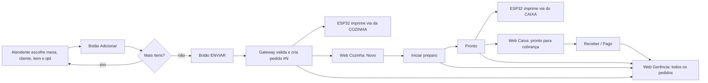

# Comandas IoT — Guia de instalação e integração

Sistema de comandas para restaurantes: o **atendente** lança o pedido no celular com o app **IoT MQTT Panel**, o pedido viaja por **MQTT**, a **cozinha** e o **caixa** acompanham numa plataforma web em tempo real e um **ESP32** imprime as vias na impressora térmica (ESC/POS).

## 1. Como tudo se conecta

```
 Celular (IoT MQTT Panel)                                   Navegador (tablet/TV/PC)
   mesa, cliente, item, qtd...                             Cozinha · Caixa · Gerência
            │  MQTT                                                 ▲  MQTT/WebSocket
            ▼                                                       │
     ┌───────────────────── Broker MQTT ──────────────────────────┐
     │   (broker.hivemq.com  ou  broker local: npm run broker)    │
     └───────▲───────────────────────────────┬────────────────────┘
             │ pedido pronto, status         │ <prefixo>/print/cozinha|caixa
      ┌──────┴───────┐                  ┌────▼─────┐   Bluetooth   ┌──────────────┐
      │ Gateway Node │                  │  ESP32   │ ────────────► │ Impressora   │
      │ (server.js)  │                  │ DevKit V1│    ESC/POS    │ 80 mm        │
      └──────────────┘                  └──────────┘               └──────────────┘
```

**Por que existe um "gateway"?** O IoT MQTT Panel é um painel genérico: cada botão ou campo publica uma mensagem simples e não monta carrinho nem soma valores. O gateway (`server/server.js`) guarda o carrinho de cada atendente, busca o preço no cardápio (`menu.json`), calcula o total, cria o pedido, publica para o ESP32 e para a web, e salva o histórico em `server/data/orders.json`. Ele também entrega a plataforma web.



## 2. Requisitos

- **PC/notebook** na mesma rede Wi‑Fi dos celulares e do ESP32, com **Node.js 18+** (nodejs.org).
- **Celulares Android** com *IoT MQTT Panel* (Play Store).
- **ESP32 DevKit V1**, Arduino IDE com suporte a ESP32, e a impressora com Bluetooth.
- Internet apenas se usar o broker público `broker.hivemq.com`.

## 3. Rodando a aplicação (PC)

```bash
cd server
npm install
```

### Passo obrigatório: defina um prefixo próprio

O broker público é **compartilhado com o mundo todo**. Edite `server/config.json` e troque `prefixo` por algo único, por exemplo `bdb-turma7-2026`. Esse mesmo texto será usado no app do celular e no ESP32. Troque também os PINs em `usuarios`.

### Opção A: broker público (mais simples)

```bash
npm start
```

### Opção B: broker local (sem internet, mais privado)

Em dois terminais:

```bash
npm run broker        # terminal 1: broker MQTT (portas 1883 e 8083)
npm run start:local   # terminal 2: gateway + web apontando para o broker local
```

No Windows (PowerShell), o `start:local` não funciona; use:
`$env:BROKER_URL="mqtt://localhost:1883"; $env:BROKER_WS="ws://{host}:8083"; node server.js`

Nos celulares e no ESP32, o endereço do broker passa a ser o **IP do PC** (veja com `ipconfig` / `ifconfig`). Libere as portas 1883, 8083 e 8080 no firewall.

### Abrindo a plataforma web

Em qualquer dispositivo da rede: `http://IP-DO-PC:8080`. Escolha o perfil e digite o PIN (padrão: cozinha `1111`, caixa `2222`, gerência `3333`).

| Perfil | O que vê e faz |
|---|---|
| **Cozinha** | Colunas *Novos* e *Em preparo*, cronômetro por pedido (amarelo após 10 min, vermelho após 20), alerta sonoro em novo pedido. Botões *Iniciar preparo* e *Pronto*. |
| **Caixa** | Pedidos prontos com preço unitário, quantidade, subtotal e total. *Receber* (Pix, dinheiro, crédito, débito) e *Reimprimir* a conta. |
| **Gerência** | Todos os pedidos, indicadores e filtros por mesa, cliente, status, faixa de valor e horário. Detalhe do pedido, cancelamento e exportação CSV. |

No topo há três indicadores: **broker**, **gateway** e **impressora** (verde = online).

### Testar sem celular e sem ESP32

```bash
npm run simular              # lança um pedido de exemplo (mesa 7)
npm run simular -- 12 Carlos # mesa 12, cliente Carlos
```

O simulador faz exatamente o que o celular fará. No broker local, defina `BROKER_URL=mqtt://localhost:1883` antes do comando.

## 4. Configurando o IoT MQTT Panel no smartphone

> Os nomes dos campos podem variar um pouco conforme a versão do app. A lógica é sempre a mesma: **tópico** + **payload**.

Convenção de tópicos (troque `PREFIXO` pelo seu e `ATENDENTE` por um nome sem espaços, p. ex. `joao`; cada atendente usa o seu e os carrinhos não se misturam):

```
PREFIXO/at/ATENDENTE/<campo>
```

### 4.1 Criar a conexão

1. Abra o app e toque em **+** (adicionar conexão).
2. *Connection name*: `Comanda`. *Broker*: `broker.hivemq.com` (ou o IP do PC, no broker local). *Port*: `1883`. Protocolo TCP, sem TLS/SSL.
3. *Client ID*: um nome único (p. ex. `cel-joao`). Usuário e senha em branco.
4. Salve, abra a conexão e crie um **Dashboard** chamado `Pedido`.

### 4.2 Painéis de envio (o atendente usa)

Em cada painel, **QoS 0 ou 1** e **Retain desligado**.

| # | Painel (tipo) | Nome | Tópico | Payload |
|---|---|---|---|---|
| 1 | **Combo Box** | Mesa | `PREFIXO/at/ATENDENTE/mesa` | opções `1`, `2`, `3`... até o número de mesas |
| 2 | **Text Input** | Cliente | `PREFIXO/at/ATENDENTE/cliente` | o texto digitado |
| 3 | **Combo Box** (um por categoria) | Item | `PREFIXO/at/ATENDENTE/item` | o **código** do item (tabela 4.5) |
| 4 | **Slider** (1 a 10, passo 1) ou Combo Box | Quantidade | `PREFIXO/at/ATENDENTE/qtd` | o número |
| 5 | **Button** | ➕ Adicionar | `PREFIXO/at/ATENDENTE/add` | `1` |
| 6 | **Text Input** | Observação | `PREFIXO/at/ATENDENTE/obs` | texto livre (ex.: "sem cebola") |
| 7 | **Button** | ↩ Desfazer | `PREFIXO/at/ATENDENTE/undo` | `1` |
| 8 | **Button** | 🗑 Limpar | `PREFIXO/at/ATENDENTE/limpar` | `1` |
| 9 | **Button** | ✅ ENVIAR PEDIDO | `PREFIXO/at/ATENDENTE/enviar` | `1` |

Dicas:

- Nos combos de **Item**, crie um combo para cada categoria (Petiscos, Lanches, Bebidas...) e aponte **todos** para o mesmo tópico `.../item`. É mais rápido que uma lista única com 59 itens.
- Se o combo tiver campos de rótulo e valor, use o nome do item como rótulo e o **código** como valor. Se tiver só um campo, use o código.
- Use **Button**, não Switch: o gateway reage a qualquer mensagem no tópico, e o Switch também publicaria ao desligar.
- A quantidade permanece no último valor escolhido. Depois de adicionar 2 cervejas, lembre de voltar para 1.
- Atalho: um Text Input apontando para `.../item` aceita `2xBBB-BACON` (quantidade + código).

### 4.3 Painéis de retorno (o atendente confere)

| Painel (tipo) | Nome | Tópico (subscribe) |
|---|---|---|
| **Text Log** ou **Text** | Resumo do pedido | `PREFIXO/at/ATENDENTE/resumo` |
| **Text** | Status | `PREFIXO/at/ATENDENTE/status` |

O *Resumo* mostra mesa, cliente, itens, quantidade, valor e **total**, atualizado a cada toque. O *Status* confirma ("Adicionado: 2x BBB bacon", "Pedido #12 enviado") ou avisa o que falta ("Faltou: mesa, cliente").

### 4.4 Fluxo de uso do atendente

1. Escolha a **Mesa** e digite o **Cliente**.
2. Escolha o **Item**, ajuste a **Quantidade** e toque em **➕ Adicionar**. Repita para cada item.
3. (Opcional) escreva uma **Observação**. Ela vale para o pedido inteiro e aparece destacada na cozinha.
4. Confira o **Resumo** e toque em **✅ ENVIAR PEDIDO**.

Mesa, cliente e ao menos um item são obrigatórios. Depois do envio o carrinho é zerado.

### 4.5 Códigos do cardápio

Os códigos e preços ficam em `server/menu.json` (edite à vontade e reinicie o gateway). Baseado no cardápio de exemplo.

**Petiscos**

| Código (payload) | Item | Preço |
|---|---|---:|
| `CAM-CRO` | Camarão Rosa Crocante 500g | R$ 164,90 |
| `CAM-MIL` | Camarão à Milanesa 350g | R$ 69,90 |
| `CAM-AO` | Camarão Alho e Óleo 350g | R$ 84,90 |
| `LULA` | Lula à Dorê 350g | R$ 58,90 |
| `ISCA-PEIXE` | Isca de Peixe (pescada) 350g | R$ 41,90 |
| `POLVO` | Polvo ao Alho e Óleo | R$ 98,90 |
| `SIRI` | Casquinha de Siri | R$ 16,90 |
| `OSTRA6` | Ostra in Natura 6un | R$ 36,90 |

**Porções**

| Código (payload) | Item | Preço |
|---|---|---:|
| `MIGNON` | Mignon acebolado 250g | R$ 99,90 |
| `MIGNON-GORG` | Mignon ao gorgonzola 250g | R$ 104,90 |
| `ENTRECOT` | Entrecot aperitivo 250g | R$ 69,90 |
| `PASSARINHO` | Frango à passarinho 250g | R$ 36,90 |
| `CALABRESA` | Calabresa acebolada 250g | R$ 30,90 |
| `COSTELA` | Costelinha barbecue 500g | R$ 98,90 |
| `MISTA-1KG` | Mista especial da casa 1kg | R$ 175,90 |

**Lanches**

| Código (payload) | Item | Preço |
|---|---|---:|
| `BBB` | Boni burger barbecue | R$ 36,90 |
| `BBB-BACON` | BBB bacon | R$ 43,90 |
| `BBB-VEG` | BBB Veg | R$ 36,90 |
| `BATATA250` | Batata frita 250g | R$ 22,90 |
| `BATATA-CB` | Batata c/ cheddar e bacon 250g | R$ 32,90 |
| `BATATA-5Q` | Batata 5 queijos 250g | R$ 41,90 |
| `PAST-CARNE` | Pastel de carne | R$ 15,90 |
| `PAST-QUEIJO` | Pastel de queijo | R$ 14,90 |
| `PAST-CAMARAO` | Pastel de camarão | R$ 18,90 |
| `CALDO-PEIXE` | Caldo de peixe | R$ 18,90 |
| `CALDO-CAMARAO` | Caldo de camarão | R$ 24,90 |

**Coquetéis**

| Código (payload) | Item | Preço |
|---|---|---:|
| `MOJITO` | Mojito | R$ 28,90 |
| `MARGARITA` | Margarita | R$ 26,90 |
| `PINA` | Piña Colada | R$ 29,90 |
| `NEGRONI` | Negroni | R$ 36,90 |
| `APEROL` | Aperol Spritz | R$ 36,90 |
| `GIN-NAC` | Gin Tônica Nacional | R$ 26,90 |
| `CAMPARI-T` | Campari Tônica | R$ 28,90 |
| `COCO-BONI` | Coco Boni | R$ 76,90 |
| `CAIPI-LIMAO` | Caipirinha Caninha 51 | R$ 21,90 |
| `CAIPI-VODKA` | Caipirinha Vodka Nacional | R$ 29,90 |
| `CAIPI-FRUTAS` | Caipira Especial de Frutas 500ml | R$ 52,90 |

**Sem álcool**

| Código (payload) | Item | Preço |
|---|---|---:|
| `COCA` | Coca-Cola | R$ 6,90 |
| `COCA-ZERO` | Coca-Cola Zero | R$ 6,90 |
| `GUARANA` | Guaraná | R$ 6,90 |
| `AGUA-SG` | Água mineral sem gás | R$ 6,00 |
| `AGUA-CG` | Água mineral com gás | R$ 6,00 |
| `SUCO-NAT` | Suco natural (copo) | R$ 13,90 |
| `SUCO-POLPA` | Suco de polpa | R$ 12,90 |
| `H2O` | H2O Limão | R$ 8,90 |

**Cervejas**

| Código (payload) | Item | Preço |
|---|---|---:|
| `CHOPP-IPA` | Chopp IPA Kairós 350ml | R$ 18,90 |
| `CHOPP-PILSEN` | Chopp Pilsen Kairós 350ml | R$ 12,90 |
| `CHOPP-HEINEKEN` | Chopp Heineken 350ml | R$ 14,90 |
| `CHOPP-AMSTEL` | Chopp Amstel 350ml | R$ 12,90 |
| `HEINEKEN600` | Heineken 600ml | R$ 24,90 |
| `AMSTEL600` | Amstel 600ml | R$ 18,90 |
| `EISEN600` | Eisenbahn 600ml | R$ 18,90 |
| `STELLA600` | Stella Artois 600ml | R$ 22,90 |
| `SCHORN-WEISS` | Schornstein Weiss 500ml | R$ 29,90 |
| `SCHORN-IPA` | Schornstein IPA 500ml | R$ 29,90 |

**Doses**

| Código (payload) | Item | Preço |
|---|---|---:|
| `DOSE-JACK` | Jack Daniel's (dose) | R$ 29,90 |
| `DOSE-ABSOLUT` | Absolut (dose) | R$ 28,90 |
| `DOSE-OHANA` | Gin Ohana (dose) | R$ 28,90 |
| `DOSE-BLACK` | Black Label (dose) | R$ 33,90 |

### 4.6 Opção avançada: pedido completo em um único envio

Publique um JSON em `PREFIXO/at/ATENDENTE/pedido`:

```json
{"mesa":"7","cliente":"Maria","obs":"sem cebola","itens":[{"cod":"BBB-BACON","qtd":2},{"cod":"HEINEKEN600","qtd":1}]}
```

## 5. ESP32 + impressora térmica

1. **Arduino IDE**: instale o pacote *esp32 by Espressif* e as bibliotecas **PubSubClient** e **ArduinoJson (7.x)**.
2. Abra `esp32/comanda_printer/comanda_printer.ino` e edite o bloco *CONFIGURE AQUI*: Wi‑Fi, broker, **PREFIXO** (igual ao do `config.json`) e `PRINTER_NAME`.
3. Placa **ESP32 Dev Module**, *Partition Scheme* **Huge APP (3MB No OTA)** (Wi‑Fi + Bluetooth + MQTT não cabem na partição padrão).
4. Ligue a impressora e faça o pareamento (se pedir PIN, costuma ser `0000` ou `1234`). Confirme o **nome Bluetooth** nas configurações do celular e use-o em `PRINTER_NAME`.
5. Grave e abra o Monitor Serial (115200). Devem aparecer `[wifi]`, `[mqtt] conectado` e `[bt] impressora conectada`; o indicador **impressora** da web fica verde.

**Impressão.** A via da **cozinha** (sem preços, itens grandes, mesa em destaque e observação) sai quando o pedido é enviado. A via do **caixa** (preço unitário, quantidade, subtotal e total) sai quando a cozinha toca em *Pronto*. Para imprimir a conta já no envio, use `"imprimirCaixaQuando": "novo"` em `server/config.json`. O botão 🖨 da tela do Caixa reimprime a conta.

**USB.** O ESP32 DevKit V1 não é "USB host", então a ligação com a impressora é por **Bluetooth**, como a descrição do projeto permite.

| Sintoma | Solução |
|---|---|
| Acentos viram símbolos | Troque `CODEPAGE` de `19` para `2` (ou o código indicado no manual do fabricante). |
| Texto cortado nas bordas | Reduza `LINE_W` para `42`. |
| `[bt] falhou` | Confirme que a impressora está ligada, pareada e que o nome confere. Desconecte o celular dela: Bluetooth clássico aceita uma conexão por vez. |
| Pedido aparece na web mas não imprime | Veja o chip *impressora* e o Monitor Serial. Os pedidos ficam na fila (até 8) enquanto a impressora estiver fora. |

## 6. Solução de problemas gerais

- **Nada chega**: o prefixo precisa ser **idêntico** no celular, no `config.json` e no firmware (diferencia maiúsculas de minúsculas).
- **Chip "gateway" vermelho**: o `server.js` não está rodando ou usa outro prefixo.
- **Web não conecta ao broker**: no broker público, páginas servidas por `https` exigem `wss://broker.hivemq.com:8884/mqtt` em `wsUrl`; na rede local (`http`) use a porta 8000.
- **Celular não abre a web**: confirme o IP do PC, o mesmo Wi‑Fi e o firewall (porta 8080).
- **"Item desconhecido"**: o código enviado não existe em `menu.json`.

## 7. Limitações conhecidas

- Os PINs protegem apenas a interface web. Quem souber o prefixo no broker público pode publicar mensagens. Para uso real, use broker local com usuário/senha e TLS.
- O histórico é um arquivo JSON (últimos 1000 pedidos). Para relatórios maiores, troque por SQLite.
- O gateway, a plataforma web e o fluxo MQTT foram testados de ponta a ponta com um broker local e um simulador de atendente. O **firmware do ESP32 não foi compilado nem testado em hardware**: comece pelo Monitor Serial e ajuste `CODEPAGE` e `LINE_W` ao seu modelo.

## 8. Estrutura do projeto

```
comanda-iot/
├── GUIA.md                       este documento
├── server/
│   ├── server.js                 gateway MQTT + servidor da web
│   ├── broker.js                 broker MQTT local (opcional)
│   ├── simular.js                simulador de atendente
│   ├── config.json               prefixo, broker, PINs
│   └── menu.json                 cardápio (códigos e preços)
├── web/                          plataforma (index.html, style.css, app.js)
└── esp32/comanda_printer/        firmware (.ino)
```

### Tópicos MQTT (referência)

| Tópico (P = prefixo) | Direção | Conteúdo |
|---|---|---|
| `P/at/<atendente>/<campo>` | celular → gateway | mesa, cliente, item, qtd, obs, add, undo, limpar, enviar, pedido |
| `P/at/<atendente>/resumo` e `/status` | gateway → celular | texto do carrinho e mensagens |
| `P/pedidos/novo` | gateway → todos | JSON de cada pedido criado |
| `P/orders` (retido) | gateway → web | lista dos pedidos mais recentes |
| `P/cmd` | web → gateway | `{id, acao}`: preparo, pronto, pago, cancelar, reimprimir |
| `P/print/cozinha`, `P/print/caixa` | gateway → ESP32 | dados do cupom |
| `P/print/status`, `P/print/log` | ESP32 → todos | online/offline e resultado das impressões |
| `P/gateway/status` (retido) | gateway → todos | online/offline |
